# Airlock architecture

Airlock is a firewall on the path between an LLM agent and the model. The agent
keeps talking the Anthropic Messages API; it only changes its base URL
(`ANTHROPIC_BASE_URL=http://127.0.0.1:8787`). Every `POST /v1/messages` is split
into segments by origin, inspected, decided by an origin-aware policy, then
forwarded (as is or sanitized) or answered locally with a synthetic reply. Every
decision lands in a hash-chained audit log.

This document is the architecture review written during the build (AI Security
Hackathon Lisbon, 2026-10-22). It describes the frozen contract
(`types.py`, `policy.py`, `engine.py`, `detectors/__init__.py`), the modules
around it, the reasons behind the main choices, and a prioritized list of
improvements. Behaviors marked **(verified)** were reproduced against the code
at review time.

## 1. Request path and trust model

```mermaid
flowchart LR
    subgraph Host["Agent host"]
        AG["Agent: Claude Code or any Messages API client"]
        EXT["Third parties: MCP servers, web pages, files, email"]
    end
    EXT -- "tool results and tool definitions" --> AG
    AG -- "POST /v1/messages" --> PX["proxy.py on 127.0.0.1:8787<br/>size cap, JSON object check"]
    PX --> EN["engine.Airlock.inspect()"]
    EN --> SG["segments.extract_segments()"]

    subgraph Sources["Segments tagged by Source"]
        SYS["SYSTEM"]
        USR["USER"]
        AST["ASSISTANT"]
        TU["TOOL_USE<br/>model emitted, already executed"]
        TR["TOOL_RESULT<br/>third party"]
        TD["TOOL_DEFINITION<br/>third party (MCP)"]
    end
    SG --> Sources
    Sources --> DT["detectors: injection, hidden,<br/>exfil, secrets"]
    EN --> TC["tools.check_tools()<br/>poisoning, shadowing, exfil params,<br/>TOFU sha256 pins"]
    DT --> PO["policy.decide()<br/>(category, source, severity) to Action"]
    TC --> PO
    PO -- "ALLOW / WARN" --> FW["forward original bytes"]
    PO -- "REDACT" --> SN["sanitize.sanitize()<br/>span removal, tool quarantine, secret mask"]
    SN --> FW
    PO -- "BLOCK" --> SY["synthetic Anthropic reply<br/>JSON or SSE, upstream never called"]
    PO -. "Decision.to_record()" .-> AU["audit.py<br/>hash-chained JSONL"]
    FW --> UP["api.anthropic.com"]
    UP -- "response relayed unchanged (JSON or SSE)" --> AG
    SY --> AG

    classDef trusted fill:#e6f4ea,stroke:#2e7d32,color:#1b1b1b;
    classDef untrusted fill:#fdecea,stroke:#c62828,color:#1b1b1b;
    classDef posthoc fill:#fff4e5,stroke:#ef6c00,color:#1b1b1b;
    class SYS,USR,AST trusted;
    class TR,TD,EXT untrusted;
    class TU posthoc;
```

### Trust model by source (default `Policy`)

| Source | Who writes it | Trust | Strictest default action |
|---|---|---|---|
| `SYSTEM` | Agent operator | Trusted | WARN at MEDIUM; hidden content at HIGH is stripped (REDACT); never BLOCK |
| `USER` | Human user (and harness text injected in user turns, see section 4, item 4) | Trusted | Same as SYSTEM |
| `ASSISTANT` | The model, earlier turns | Trusted | Same as SYSTEM |
| `TOOL_USE` | The model, tool call arguments seen again in history | Semi trusted, post hoc | WARN at HIGH, BLOCK at CRITICAL |
| `TOOL_RESULT` | Third parties (web, files, MCP output, documents, search results) | Untrusted | WARN at MEDIUM, REDACT at HIGH, BLOCK at CRITICAL |
| `TOOL_DEFINITION` | MCP servers (name, description, schema text) | Untrusted | WARN at MEDIUM, quarantine the whole tool at HIGH (or BLOCK if `quarantine_poisoned_tools=False`) |
| any | `SECRET` category | n/a | REDACT (mask) when `redact_secrets=True`, else WARN |
| any | `PII` category | n/a | WARN |

`types.UNTRUSTED_SOURCES = {TOOL_RESULT, TOOL_DEFINITION}` is the single place
that says which content a third party can write; `proxy.block_text` uses it to
explain blocks.

Two trust boundaries are outside what a request-side proxy can see, and the
design states them openly:

* **Tool calls are inspected after they ran.** A `tool_use` block reaches
  Airlock only in the next request, after the client executed it. Request-side
  `TOOL_USE` rules stop the loop from continuing on top of a dangerous call;
  they do not prevent the call. Prevention needs response-side inspection
  (roadmap R1).
* **Server tools run inside the API.** `web_search`, `web_fetch` and code
  execution results are produced upstream and reach the model in the same turn
  without crossing Airlock. Airlock only sees them later, in history.

## 2. Module map

| Module | Responsibility | Key API |
|---|---|---|
| `airlock/types.py` (frozen) | Data model: `Source`, `Severity`, `Action` (ordered, `max()` = strictest), `Category` with OWASP LLM Top 10 mapping, `Segment`, `Finding` (audit-safe `to_record()` without evidence), path helpers `get_at` / `set_at` | `Path = tuple[str or int, ...]` |
| `airlock/segments.py` | Split a Messages API body into origin-tagged segments with exact paths; defensive on junk input | `extract_segments(body) -> list[Segment]` |
| `airlock/detectors/` | Stateless text detectors, one module per family: `injection` (EN/ES/PT), `hidden` (tag smuggling, zero width, bidi, HTML comments, CSS hidden, base64), `exfil` (markdown image exfil, OAST domains, dangerous commands), `secrets` | `detect(segment) -> list[Finding]`; registry `TEXT_DETECTORS` |
| `airlock/tools.py` | Tool definition checks: poisoning, shadowing, exfil parameters, name collisions, rug pulls via trust-on-first-use sha256 pins | `check_tools(tools, store)`, `FingerprintStore(path)` |
| `airlock/policy.py` (frozen) | Origin-aware decision table | `Policy` (frozen dataclass), `action_for`, `decide` |
| `airlock/sanitize.py` | Deep copy and rewrite: replace spans back to front, strip invisible characters, mask secrets, quarantine tools, reset a `tool_choice` that names a quarantined tool | `sanitize(body, findings) -> (body, quarantined)` |
| `airlock/engine.py` (frozen API) | Orchestration: segments, detectors (memoized per segment by `SegmentCache`), tool checks, dedupe, decide, sanitize | `Airlock(policy, fingerprints, detectors, cache).inspect(body) -> Decision` |
| `airlock/audit.py` | Append-only JSONL hash chain (`hash = sha256(prev_hash + canonical JSON)`), crash recovery from the last valid line, `verify()` | `AuditLog(path).append(record)`, `verify(path)` |
| `airlock/proxy.py` | FastAPI app, the only module with third-party deps: 10 MB cap, JSON object check, inspection (fail closed), audit append, forward or synthetic BLOCK (JSON or SSE in the official event order), `x-airlock-*` headers, `/healthz`, `/airlock/stats`, `/airlock/audit/verify`, uninspected passthrough for other `/v1/*` paths | `create_app(airlock, upstream_url, audit_path, transport)` |
| `airlock/cli.py`, `__main__.py` | `scan`, `serve`, `audit-verify` | `python -m airlock ...` |
| `airlock/reputation.py`, `airlock/attest.py` | Reputation per MCP tool and server, ERC-8004 feedback documents, Stellar testnet anchoring and verification | `AIRLOCK_REPUTATION`, `scripts/testnet_attest.py` |
| `airlock/static/console.html` | Live console (Shield score, decision feed, reputation ladder, audit status) | `GET /airlock/ui` |

### Extension points

1. **Custom detectors.** Any callable `Segment -> list[Finding]` plugs in
   without touching the core:
   `Airlock(detectors=(*TEXT_DETECTORS, my_detect))`. Rules: be stateless and
   deterministic (history is re-inspected every turn, see 3.6), report
   `start`/`end` offsets into the original `segment.text` (the sanitizer uses
   them), copy `segment.source`, `segment.path` and `segment.tool_name` into the
   finding, never put raw secrets in `message`, and stay linear time (no
   catastrophic regex backtracking on 1 MB tool results).
2. **Policy fields.** `Policy` is a frozen dataclass of thresholds per source
   (`untrusted_block_at`, `untrusted_redact_at`, `untrusted_warn_at`,
   `tool_definition_quarantine_at`, `tool_use_block_at`, `tool_use_warn_at`,
   `trusted_warn_at`, `trusted_strip_hidden_at`) and switches
   (`quarantine_poisoned_tools`, `redact_secrets`). New fields must have
   defaults so existing callers keep working. Profiles are just instances
   (for example a strict CI profile with `untrusted_block_at=Severity.HIGH`).
3. **FingerprintStore persistence.** `FingerprintStore(path=None)` is in
   memory; with a path (`--fingerprints` or `AIRLOCK_FINGERPRINTS`) pins
   survive restarts, which is what makes rug-pull detection meaningful across
   sessions. Any object with the same interface (for example SQLite or a shared
   team store) can be passed to `Airlock(fingerprints=...)`.
4. **Judge hook (proposed, not in the frozen contract).** A second opinion for
   ambiguous segments, placed between detection and `decide()`:
   `Judge = Callable[[Segment, list[Finding]], Severity | None]`. It may raise
   or lower the severity of findings on untrusted segments in an ambiguous band
   (MEDIUM to HIGH), and may add a finding on an untrusted segment with no
   regex hit. It must never lower CRITICAL, never see unmasked secrets (run the
   secrets detector and mask first), and must be cached by content hash so the
   same text gets the same verdict every turn. Cost control in roadmap R2.

## 3. Design decisions and why

### 3.1 Origin-aware policy
The same words mean different things depending on who wrote them. A user
asking how to defend against "ignore previous instructions" is legitimate; a
web page saying it to the agent is an attack. ArkivGate scanned only
user/system text, which produced false positives on security conversations and
was blind to the actual indirect injection vector (tool results). Airlock keys
the action on `(category, source, severity)`, so trusted sources are never
blocked for talking about attacks and untrusted sources are never allowed to
give instructions.

### 3.2 REDACT vs BLOCK
REDACT removes only the malicious span (replaced by a visible
`[removed by Airlock: RULE]` label), masks secrets as `[REDACTED:RULE]`, and
quarantines poisoned tools while keeping the rest of the toolset. The agent
keeps working and the model is told something was removed, so it can choose a
different source. BLOCK is reserved for CRITICAL findings where partial removal
is not trustworthy (for example a tool result that is mostly an attack
payload). BLOCK never calls upstream: the proxy answers with a synthetic
Anthropic-shaped message in JSON or SSE so every SDK parses it. See section 5
for the cost of BLOCK on autonomy.

### 3.3 Trust on first use pins for tools
MCP tool definitions are prompt text written by a third party and can change at
any time (rug pull). Airlock pins `sha256` of each definition the first time it
sees it and flags later changes. TOFU needs no registry or signatures, which
fits a local tool tonight. Its known limits: a definition poisoned before first
sight is pinned as is (the static poisoning checks cover that case), and a
legitimate upgrade looks like a rug pull (see quick win QW8).

### 3.4 Stdlib-only core
Everything except `proxy.py` is Python stdlib. The engine can be embedded in
any agent framework, run in CI with `python -m airlock scan`, and audited
without a dependency tree. Fewer dependencies is also a supply chain choice,
which matters for a security tool that sees every prompt and API key header.

### 3.5 Hash-chained audit log
Each JSONL record carries `seq`, `ts`, `prev_hash` and `hash`. Editing,
reordering or deleting a line breaks the chain from that point; `audit-verify`
and `/airlock/audit/verify` check it. Records never contain prompt text or
evidence: only rule ids, categories, OWASP ids, sources, paths, actions and a
hash of the raw body. Tail truncation is undetectable without an external
anchor, which is why roadmap R6 anchors the head hash.

### 3.6 Determinism and replayed history
Clients keep the original, unsanitized conversation and resend all of it on
every turn. Airlock therefore re-inspects and re-sanitizes the whole history on
each request. Detectors and the sanitizer must be deterministic so the model
sees the same redacted history every turn, which also keeps the prompt cache
prefix stable. Any probabilistic layer (judge) must be cached by content hash
for the same reason.

Because text detectors are pure functions of the segment, `Airlock` memoizes
their findings in `SegmentCache` (`engine.py`), a bounded LRU keyed by the
whole segment (text, source, path, tool) and capped by entries and total
characters. A replayed history costs a lookup instead of a rescan: a 1 MB tool
result takes about 1.2 s to scan the first time and about 0.01 ms on every
later turn. Tool checks are never cached, because rug-pull pins are state.

### 3.7 Fail-open vs fail-closed

| Component | Behavior today | Choice and reason |
|---|---|---|
| Body over 10 MB, invalid JSON, non-object JSON | 413 / 400, not forwarded | Fail closed: upstream would reject anyway, and an uninspectable body must not pass |
| `Airlock.inspect` raises | 500, not forwarded | Fail closed: an inspection bug must not let traffic through |
| One detector raises | Whole inspection raises (no per-detector isolation) **(verified by reading)** | Too coarse: one bug on one segment blocks every request of the session. See QW2 |
| `segments.extract_segments` hits junk | Skips that part of the body (`system`, `messages` or `tools`) | Fail open for availability. Risk: a whole part goes uninspected silently. See QW4 |
| `sanitize` cannot deep copy or follow a path | Returns the original text for that path | Fail open on a REDACT decision. See QW3 (post-sanitize verification) |
| Audit append fails (`OSError`) | Logged, request still served | Fail open for availability; make it configurable for compliance deployments |
| Upstream unreachable | 502 Anthropic-shaped error | Neutral: the client retries as it would against the API |
| Other `/v1/*` paths | Forwarded uninspected | Fail open. Includes `/v1/messages/batches`, see QW6 |

## 4. Gaps found during review

1. **Non-object body crashes the engine (verified).** `Airlock().inspect([])`
   raises `AttributeError` at `body.get("tools")`. The proxy guards it, but the
   engine is also the library and CLI entry point.
2. **Server tool results are skipped (verified).** In `segments._tool_result`,
   `web_fetch_tool_result` has a dict `content` (a `web_fetch_result` holding a
   `document`), which is ignored, and `web_search_result` titles are not
   extracted. A poisoned fetched page in history is never inspected.
3. **Unknown roles are trusted (verified).** `_ROLE_SOURCE.get(role, Source.USER)`
   tags any unknown role as USER.
4. **Harness text is trusted.** Content an agent harness injects into user
   turns (system reminders, attached file contents, hook output) is tagged
   USER. That is correct for the operator's own text but not for third-party
   content it quotes. Roadmap R7 (provenance markers) addresses it.
5. **Batch API bypass.** `POST /v1/messages/batches` goes through the
   uninspected passthrough route, so batched requests reach the model without
   inspection. A trailing slash (`/v1/messages/`) also lands in passthrough.
6. **Query string dropped.** The inspected route forwards to
   `{upstream}/v1/messages` without `request.url.query` (SDK beta calls use
   `?beta=true`), while passthrough keeps it.
7. **Sticky BLOCK.** See section 5.

## 5. Autonomy: running without a human in the loop

The goal is that Airlock protects an unattended agent without turning every
detection into a stop that only a human can clear. Three mechanisms today
depend on a human:

1. **BLOCK ends the turn.** The synthetic reply has `stop_reason: end_turn`,
   so an agent loop (Claude Code, Agent SDK) stops and waits for the user. The
   block text even says "ask the user how to proceed".
2. **BLOCK is sticky.** The client keeps the poisoned tool result in its
   history and resends it on every later request. The same finding fires again,
   so every following turn is blocked until a human rewinds or clears the
   conversation.
3. **Rug-pull quarantine is permanent.** A legitimately upgraded MCP tool stays
   quarantined until someone re-pins it by hand.

Design answer, in order of impact:

* **Withhold instead of block for untrusted content (QW1).** For a CRITICAL
  finding in a `TOOL_RESULT`, replace the whole segment with
  `[removed by Airlock: RULE]` (REDACT over the full span) and forward. The
  model learns the tool output was withheld and continues with other sources;
  the history is sanitized deterministically every turn, so nothing is sticky.
  BLOCK remains for strict profiles and for CRITICAL `TOOL_USE`.
* **Acknowledged blocks (QW7).** When BLOCK is kept, a finding located before
  an Airlock synthetic reply in the history was already handled once; downgrade
  it to REDACT on later requests.
* **Auto re-pin benign tool upgrades (QW8).** A changed definition with no
  other finding is a WARN plus a new pin; only a changed definition that also
  trips a poisoning or text detector is quarantined.
* **Response-side inspection (R1)** is the real control for dangerous tool
  calls: replacing a dangerous `tool_use` in the stream with a text block lets
  the model recover in the same loop instead of needing a human after the fact.

## 6. Improvements

### 6.1 Quick wins (each under 10 minutes, apply after integration)

| # | File and function | Change | Why |
|---|---|---|---|
| QW1 | `airlock/policy.py` `Policy` + `airlock/engine.py` `Airlock.inspect` | Add `withhold_untrusted_instead_of_block: bool = True`. After `decide()`, for each finding with action BLOCK and `source is Source.TOOL_RESULT`: `findings[i] = dataclasses.replace(f, start=0, end=len(get_at(body, f.path)))`, `actions[i] = Action.REDACT`; recompute `action = max(actions, default=Action.ALLOW)` | Agent continues without a human; removes sticky BLOCK (section 5) |
| QW2 | `airlock/engine.py` `Airlock.inspect` | Wrap each `detector(segment)` and `check_tools(...)` call in `try/except Exception`; collect `f"{getattr(detector, '__module__', '?')}: {type(exc).__name__}"` into a new `Decision.errors: list[str]` (default empty) and add it to `to_record()`. If an error happened on a segment in `UNTRUSTED_SOURCES`, floor the action at WARN | One detector bug no longer blocks the whole session; failures are audited |
| QW3 | `airlock/engine.py` `Airlock.inspect` | After `sanitize()`, re-run the text detectors on `extract_segments(out_body)` and `decide()` again (do not re-run `check_tools`, it mutates pins). If the residual action is REDACT or BLOCK, set `action = Action.BLOCK` | Fail closed when a REDACT did not actually remove the span (stale path, deep copy failure) |
| QW4 | `airlock/engine.py` `Decision` / `Airlock.inspect` | Add `segments: int` to `Decision` and `to_record()` (`len(extract_segments(body))`); also guard the top: `if not isinstance(body, dict): body = {}` and pass `tools if isinstance(tools, list) else []` to `check_tools` | Fixes the verified crash; "0 segments inspected" in the audit exposes silent extractor fail-open |
| QW5 | `airlock/segments.py` `_messages` and `_tool_result` | Default unknown roles to `Source.TOOL_RESULT` (`_ROLE_SOURCE.get(role, Source.TOOL_RESULT)`). In `_tool_result`, if `content` is a dict wrap it in a list; for `inner["type"] == "web_fetch_result"` call `_untrusted_block(inner["content"], (*inner_path, "content"), name)`; for `web_search_result` emit a `TOOL_RESULT` segment for `title` | Closes the verified server tool and role gaps |
| QW6 | `airlock/proxy.py` `passthrough` and `messages` | In `passthrough`, if `rest.strip("/")` starts with `messages` and is not `messages/count_tokens`, return `_error(403, "permission_error", "Airlock does not inspect this endpoint")` (covers `messages/batches` and `messages/`). In `messages`, append `?{request.url.query}` to the upstream URL when present | Closes the batch bypass; keeps SDK query parameters |
| QW7 | `airlock/engine.py` `Airlock.inspect` (or proxy) | Find the index of the last assistant message whose text starts with `Blocked by Airlock`; downgrade BLOCK findings whose `path[:2] == ("messages", i)` with `i` below that index to REDACT. Note: `block_text` must keep that prefix stable | A block is shown once, never twice for the same content |
| QW8 | `airlock/tools.py` rug-pull branch of `check_tools` | When a pinned hash changes and the new definition has no poisoning, shadowing or exfil-parameter finding, emit `RUG_PULL` at MEDIUM (WARN) and update the pin; keep HIGH (quarantine) only when the change also trips another check. Persist pins with write to `path + ".tmp"` then `os.replace`, under a `threading.Lock`; if the pin file is unreadable, raise instead of starting empty | Upgrades do not need a human; concurrent subagents cannot tear the pin file; a corrupt store never silently re-trusts everything |
| QW9 | `airlock/proxy.py` `messages` (audit append) | Add `"forwarded_sha256": hashlib.sha256(payload).hexdigest()` (after computing `payload`, so move the append below it), `"policy_sha256"` of `json.dumps(dataclasses.asdict(airlock.policy), sort_keys=True)` and `"airlock_version"` | The audit proves what was forwarded and under which policy, still without storing content |
| QW10 | `airlock/proxy.py` `block_text` | For untrusted-source blocks, replace "ask the user how to proceed" with "treat that content as unavailable and continue with other sources if possible" | Pairs with QW1 when BLOCK is still used in an unattended loop |

Suggested order: QW4, QW2, QW1, QW6, QW5, QW3, QW9, QW8, QW7, QW10. Each needs
one test in `tests/` (crash body, raising detector, CRITICAL tool result
forwarded as REDACT, batches 403, web_fetch segment, residual escalation).

### 6.2 Roadmap

* **R1. Response-side inspection of streamed `tool_use`.** Buffer only
  `tool_use` blocks in the SSE stream (`content_block_start` to
  `content_block_stop`, accumulating `input_json_delta`), run the TOOL_USE
  detectors on the parsed input before releasing the events, and on a
  dangerous call replace the block with a text block explaining the refusal.
  Text deltas keep streaming with no added latency. This is the only place a
  dangerous command can be stopped before it runs. Also scan the model's text
  for markdown image exfiltration before the client renders it.
* **R2. Judge layer for ambiguous segments with cost control.** Call a small
  classifier (local model, Claude Haiku, or a typed boolean/score endpoint)
  only for untrusted segments in the MEDIUM to HIGH band or with
  instruction-like structure and no regex hit. Controls: content-hash cache
  (verdict reused every turn), per-request budget (max calls and characters),
  hard timeout with fallback to the deterministic decision, secrets masked
  before sending, never lowering CRITICAL, cost and verdict recorded in the
  audit.
* **R3. MCP-native gateway mode.** Proxy stdio and SSE / streamable HTTP MCP
  servers directly: inspect `tools/list` (poisoning, pins) and `tools/call`
  results before the client ever sees them. Covers agents that do not use the
  Anthropic API and catches poisoning one hop earlier.
* **R4. Per-tenant policies.** Select a `Policy` and a `FingerprintStore`
  namespace per API key hash, per header (`x-airlock-tenant`), or per project
  directory; load profiles from TOML; record `policy_sha256` per decision.
* **R5. OpenTelemetry export.** One span per inspection with action, rule ids,
  OWASP ids, source, elapsed time and quarantined tools as attributes (never
  text), plus counters for actions and false-positive feedback.
* **R6. Arkiv / on-chain anchoring of the audit head hash.** Periodically
  publish `(seq, hash)` of the chain head to Arkiv or another append-only public
  ledger. That makes tail truncation and full-log replacement detectable, which
  a local chain alone cannot do.
* **R7. Spotlighting and datamarking of untrusted content.** For WARN-level
  tool results, wrap the content in explicit delimiters with a random per
  request marker and a short system note that text inside them is data, not
  instructions. Add provenance markers so harness-quoted third-party content
  inside user turns can be tagged as untrusted.
* **R8. Detection depth.** Unicode NFKC and confusables normalization with an
  offset map back to the original text, one level of base64 / URL decoding
  before rescanning, and OCR or caption checks for image blocks. (The
  per-segment result cache that keeps latency flat as conversations grow is
  done: `SegmentCache` in `engine.py`, also the base for the R2 cache.)
* **R9. Server tool policy.** Optional removal of server tools (`web_search`,
  `web_fetch`, code execution) from `tools`, since their results bypass
  request-side inspection in the same turn.
